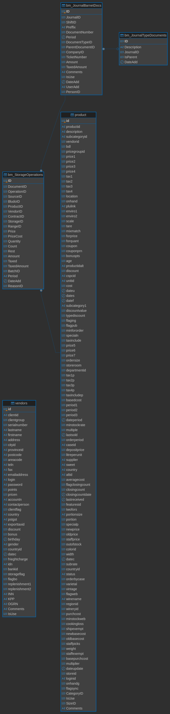
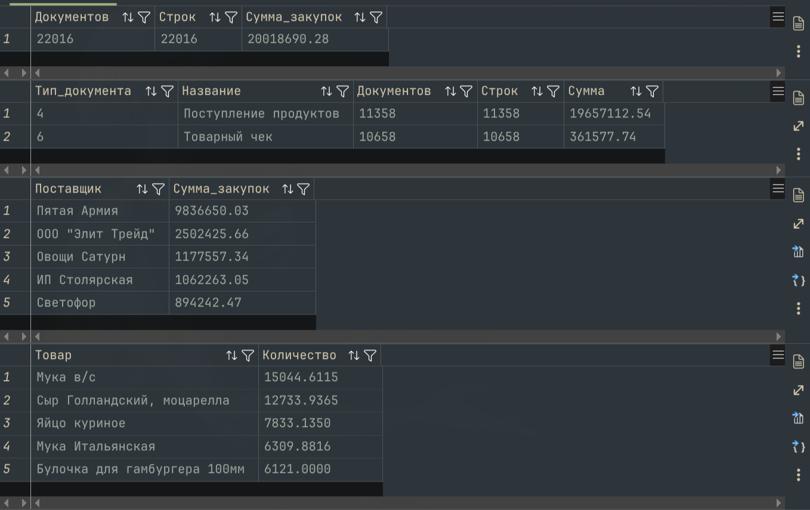
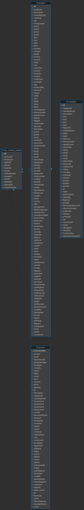
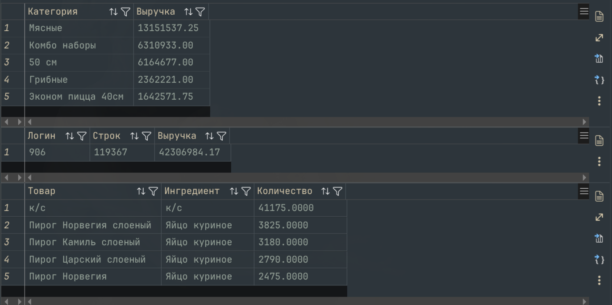
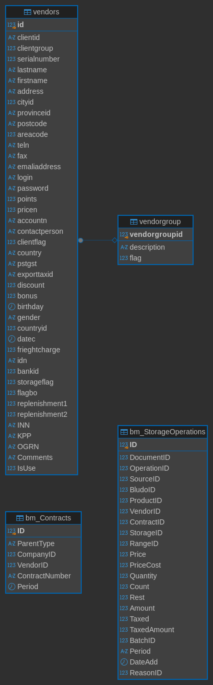
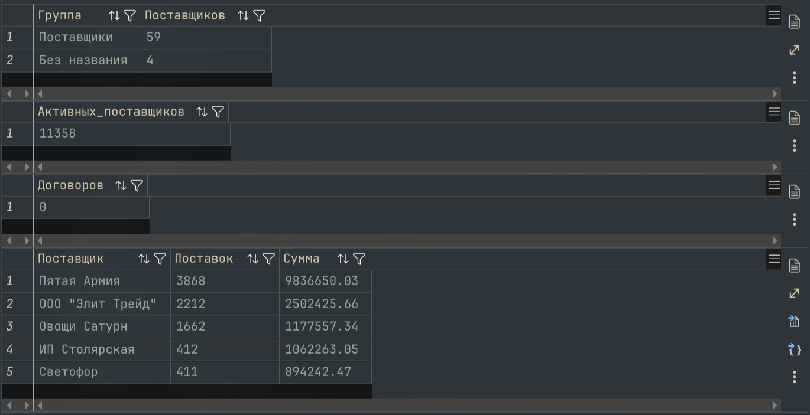
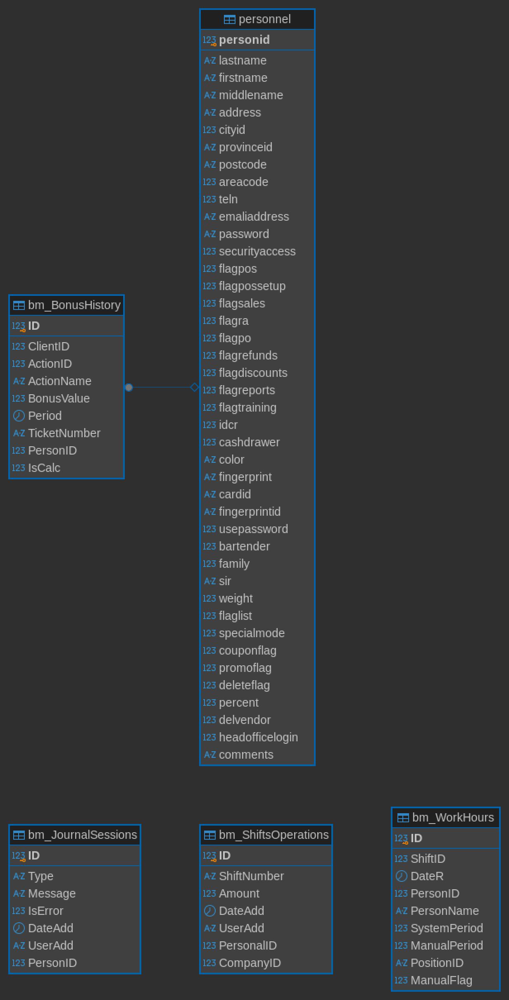
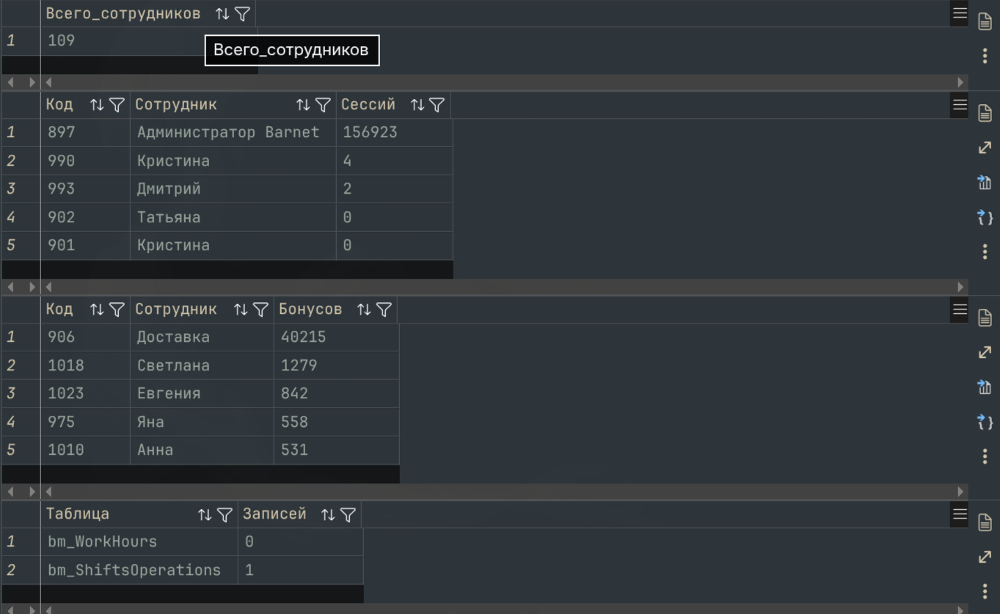
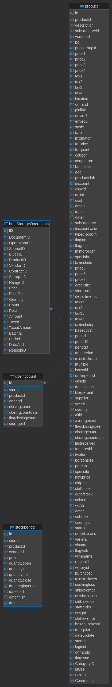
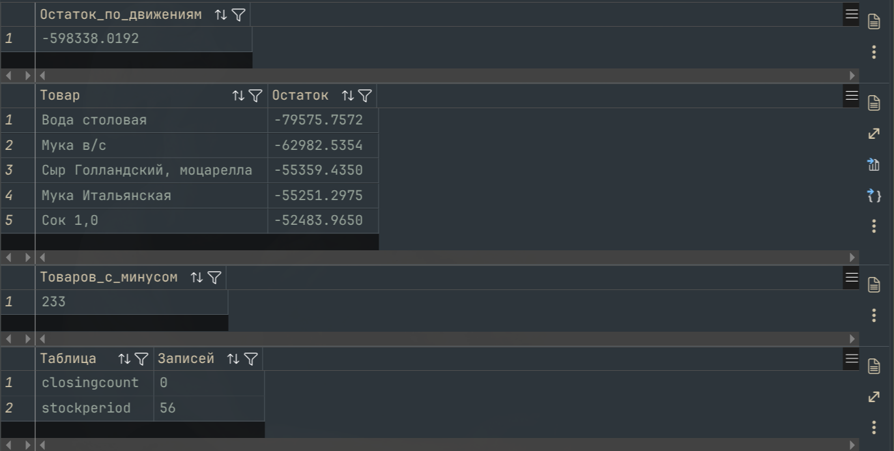

# Анализ базы данных Front

## 1. Анализ закупки продукции
**Вывод:** Половина всех привезенных товаров закупается у одного главного поставщика. Закупки оформляются через документы (шапки) и складские строки.

**Основные и связанные таблицы:**
* `bm_JournalBarnetDocs` (Шапка документа закупки)
  * `ID` — ключ документа (Пример: 465980)
  * `DocumentTypeID` — тип документа (Пример: 4)
* `bm_StorageOperations` (Строки закупки)
  * `ID` — номер строки (Пример: 6326063)
  * `DocumentID` — ссылка на шапку документа (Пример: 465980)
* `bm_JournalTypeDocuments` (Справочник типов документов)
  * `ID` — ключ типа (Пример: 4)
  * `Description` — название (Пример: Поступление продуктов)
* `product` (Справочник товаров)
  * `id` — код товара (Пример: 4337)
  * `description` — название (Пример: Бананы)
* `vendors` (Справочник поставщиков)
  * `id` — код поставщика (Пример: 211)
  * `firstname` — название (Пример: Пятая Армия)

---

## 2. Анализ продажи товара
**Вывод:** Больше всего денег приносят мясные категории. При этом все чеки в системе пробиты через один системный логин (906). 

**Основные и связанные таблицы:**
* `journal` (Журнал продаж / чеки)
  * `transnumber` — номер строки чека (Пример: 1951181)
  * `loginid` — кто пробил чек (Пример: 906)
  * `amount` — сумма (Пример: 50.00)
* `bm_Journal_Details` (Детализация продаж / ингредиенты)
  * `ID` — ключ детализации (Пример: 224362909)
  * `SourceID` — ссылка на строку чека (Пример: 1707073)
* `product` (Справочник товаров)
  * `id` — код товара (Пример: 4420)
  * `description` — название (Пример: Соус Барбекю)
* `category` (Категории меню)
  * `id` — код категории (Пример: 152)
  * `description` — название (Пример: Мясные)

---

## 3. Анализ взаимоотношений с поставщиками
**Вывод:** База разделяет поставщиков на группы, но договоры с ними физически не заносятся в систему (таблица пустая).

**Основные и связанные таблицы:**
* `vendors` (Список поставщиков)
  * `id` — код (Пример: 91)
  * `clientgroup` — ссылка на группу (Пример: 32)
* `vendorgroup` (Группы поставщиков)
  * `vendorgroupid` — код группы (Пример: 31)
  * `description` — название (Пример: Поставщики)
* `bm_StorageOperations` (Строки закупок у поставщиков)
  * `VendorID` — код поставщика (Пример: 91)
* `bm_Contracts` (Договоры)
  * `ID` — номер договора (Пример: пустая таблица)

---

## 4. Анализ работы персонала
**Вывод:** В базе заведено более 100 человек, но система не используется для учета их рабочего времени и смен (таблицы пустые). В основном сохраняется только история входов и бонусы.

**Основные и связанные таблицы:**
* `personnel` (Сотрудники)
  * `personid` — код (Пример: 906)
  * `firstname` — имя (Пример: Доставка)
* `bm_JournalSessions` (История действий и сессий)
  * `ID` — ключ события (Пример: 174072)
  * `PersonID` — код сотрудника (Пример: 897)
* `bm_BonusHistory` (История бонусов)
  * `ID` — ключ записи (Пример: 84860)
  * `PersonID` — кому начислен бонус (Пример: 906)
* `bm_WorkHours` (Учет рабочего времени)
  * `ID` — номер смены (Пример: пустая таблица)
* `bm_ShiftsOperations` (Учет кассовых смен)
  * `ID` — номер смены (Пример: 65)

---

## 5. Анализ остатков
**Вывод:** Программа хранит только приход и расход товаров. Из-за отсутствия записей о начальных остатках со склада текущее количество уходит в минус.

**Основные и связанные таблицы:**
* `bm_StorageOperations` (Движения товаров)
  * `ProductID` — код товара (Пример: 4377)
  * `OperationID` — тип операции (Пример: 1 - приход, 2 - расход)
  * `Count` — количество (Пример: 6.00)
* `product` (Справочник товаров)
  * `id` — код товара (Пример: 4337)
* `closingcount` (Зафиксированные остатки на дату)
  * `id` — ключ записи (Пример: пустая таблица)
* `stockperiod` (Периодные остатки)
  * `id` — ключ записи (Пример: 1)
  * `datebeginperiod` — дата начала периода (Пример: 2015-02-17)

